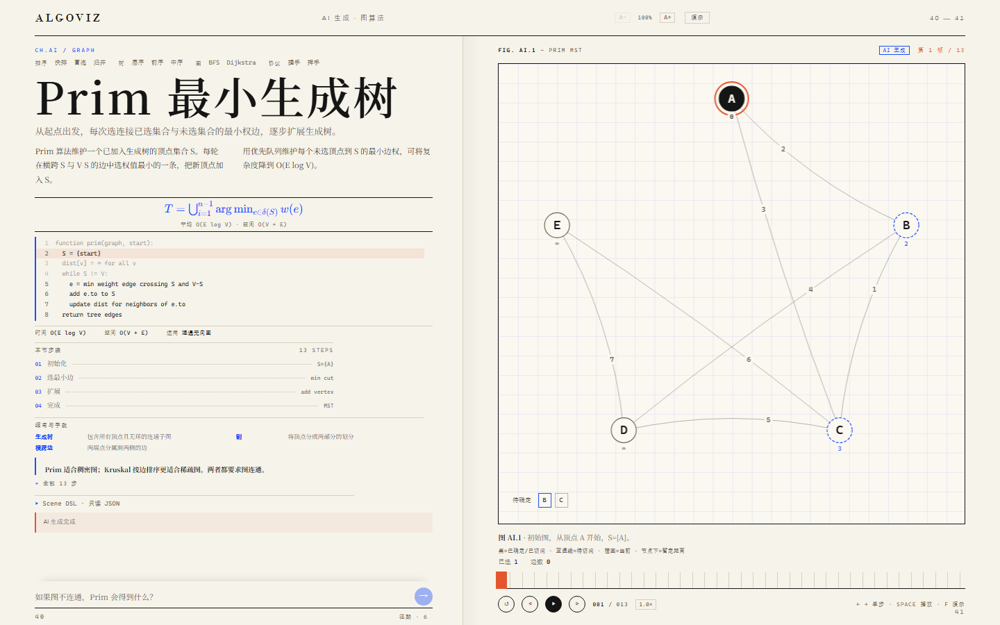
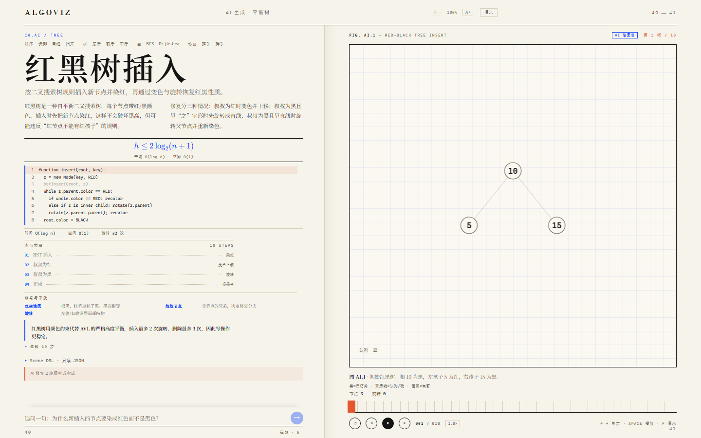

# AlgoViz · 算法视界

> 说一句原理，生成一段可单步、可调参、可回放的算法动画。

面向计算机 / 理工科学生的「讲义双页」式算法可视化工作台：左页讲解（正文、公式、伪代码），右页图版（可播放的算法动画 + 标尺时间轴）。自然语言生成 → 结构化 Scene DSL → 可复现的动画。


## 状态

- ✅ 视觉定稿：讲义双页（The Spread）
- ✅ 双页版式 + 数组图版 + 三种排序（快排 / 冒泡 / 归并）
- ✅ 树图版 + 三种遍历（层序 / 前序 / 中序）
- ✅ 图图版 + BFS / Dijkstra（环形布局、边权、松弛与最短路高亮）
- ✅ 时序图版 + TCP 三次握手 / 四次挥手（参数可开丢包重传；含 SYN / ACK / FIN / TIME-WAIT / 2MSL 等缩写与 seq / ack 字段注释）
- ✅ 协议缩写与字段注释：左页两列术语表，正文、步骤文案与伪代码注释也会在第一次出现时给中文解释
- ✅ Scene DSL v2：四态联合（array / tree / graph / sequence）+ Zod + 业务校验 + 规则路由
- ✅ LLM 代理 `/api/llm`：Key 只在 Node 侧，dev / preview 通用；已验通 DeepSeek 非流式与 SSE
- ✅ 参数注记：排序规模 4–16（冒泡/归并 4–12）、快排基准策略、树高 3–4 层、图起点、TCP 丢包开关，改参数即时重算
- ✅ 过程量：每帧显示比较 / 交换 / 已就位；树版显示已访问与队列长度；图版显示已访问 / 队列、已确定 / 待确定
- ✅ 教学交互：点伪代码跳帧、点大纲跳关键步、展开全部步骤、`F` 板书模式、往期讲义
- ✅ 投影字号：页眉 `A−` / `A+` 四档（100% / 112% / 126% / 142%），`T` 放大、`Shift+T` 缩小；正文、公式、代码、图注、图例与画布节点/边权标签一起放大
- ✅ 图例：四类图版在右页图注下方直接标注「黑 = 已访问 / 蓝虚线 = 待访问 / 橙圈 = 当前 / 虚线 = 丢包」等含义
- ✅ 可访问性与移动端：Space / Enter 不再被全局快捷键劫持；标尺可实时拖拽；0.5× 慢放；播完可从头重播；手机数组最大规模不裁切，往期抽屉可用
- ✅ KaTeX 公式与「Scene DSL · 只读 JSON」抽屉
- ✅ AI 生成：非内置主题走 `/api/llm` SSE 流式生成 → JSON 解析 → Zod/业务校验 → 质量线（排序至少 24 帧、8 个元素）→ 最多 3 轮自动修复 → 右页上屏；左侧显示流式 trace，可停止，来源标注「AI 生成 / AI 修复后」
- 🚧 11/15 计划：AI 历史（localStorage + `#ai=` 恢复）与「直接讲解」问答模式
- ⬜ P2（不阻塞提交）：PNG / Markdown / GIF / 教学卡片导出；完整分享链接

> 比赛硬性交付、已完成证据、待办与需要你确认的事项，见 [交付台账](docs/02-交付台账.md)。

## 场景

| 场景 | 图版 | 默认步数 | 参数 | 特点 |
|---|---|---|---|---|
| 快排 | 数组 | 51 | n 4–16、基准 末元素/三数取中 | Lomuto 分区 |
| 冒泡 | 数组 | 72 | n 4–12 | 相邻比较、稳定 |
| 归并 | 数组 | 78 | n 4–12 | 双指针合并 + 左右辅助段、O(n) 辅助空间 |
| 层序 | 树 | 24 | 树高 3–4 层 | 队列、逐层展开 |
| 前序 | 树 | 31 | 树高 3–4 层 | 栈、右孩子先压 |
| 中序 | 树 | 39 | 树高 3–4 层 | 一路向左、BST 升序 |
| BFS | 图（环形） | 15 | 起点 A / D | 队列、逐层扩散 |
| Dijkstra | 图（环形） | 17 | 起点 S / A | 暂定距离、松弛、最短路高亮 |
| 握手 | 时序 | 5（丢包 6） | 正常 / 丢包 | SYN、SYN+ACK、ACK；丢包重传；10 条缩写/字段注释 |
| 挥手 | 时序 | 6（丢包 7） | 正常 / 丢包 | 半关闭、TIME-WAIT、2MSL；10 条缩写/字段注释 |

在页眉下方按「排序 / 树 / 图 / 协议」四组切换，或访问 `/?scene=quick|bubble|merge|levelorder|preorder|inorder|bfs|dijkstra|handshake|wave`。
参数也能写进地址：`/?scene=quick&size=8&pivot=1`、`/?scene=levelorder&levels=3`、`/?scene=handshake&loss=1`；`&step=12` 跳到第 13 帧。

**图版：Dijkstra 最短路**


**图版：TCP 三次握手**


> 规模上限来自 DSL 的 120 步约束：n = 16 的快排已经 115 步，n = 12 的冒泡 104 步。再大就只能压缩讲解粒度，不如把上限标在参数表里。

## 教学操作

- **点伪代码**：跳到该行下一次出现的步骤，不用拖标尺找「基准归位」；没有对应动画的行会直接禁用。
- **点大纲 / 全部步骤**：四个关键阶段与全部单步都能直接跳。
- **拖标尺**：点击或按住拖动都实时跳帧；0.5× / 1× / 1.5× / 2× 四档速度，播到最后一帧再按播放会从头开始。
- **`F` 板书模式**：隐藏左页、图版铺满，`Esc` 退出；页眉「演示」按钮同效。
- **投影字号**：页眉 `A−` / `A+` 调 100% / 112% / 126% / 142% 四档，`T` 放大、`Shift+T` 缩小；正文、公式、代码、图注与画布标签一起变大，左页可滚动。
- **往期讲义**：页脚「往期」记录最近 6 个场景与参数，刷新后自动回到上次的一页。
- **过程量**：图注下的「比较 / 交换 / 已就位」随帧变化，讲复杂度时可以直接指着说；归并改为「比较 / 写入」，图版换成「已确定 / 待确定」。
- **缩写与字段**：协议场景左页列出 10 条术语/字段（SYN / ACK / FIN / TIME-WAIT / 2MSL / seq / ack…），正文、步骤文案和伪代码第一次出现时也带中文解释。
- **只读 JSON**：左页底部展开「Scene DSL」，能看到当前这一页的完整结构，可一键复制。


## AI 生成

页眉下方的追问输入框：命中内置路由（快排 / 层序 / BFS / 握手…）会直接切换；没有命中的主题会走 AI。

- 例如「插入排序」「Prim 最小生成树」「二分查找」「UDP 为什么不可靠」。
- 生成时页眉显示阶段，左页底部显示流式 trace、已收到字数与「停止」按钮。
- 输出先经过 `JSON.parse`（自动剥离 ```json 围栏）→ Zod 结构校验 → 业务规则 → 质量线（array/tree/graph 至少 8 帧、最后一帧 `doneAll`、`codeLine` 范围）。
- 校验失败会把问题清单回喂模型，最多修复 3 轮；成功后右页上方标注「AI 生成」或「AI 修复后」。
- AI 场景暂不写往期、不写 URL、刷新回到内置场景；AI 历史/直接讲解放到 11/15，导出放到 P2。



修复路径也真实跑过：红黑树插入第一次输出因父节点被旋转判为不合法，经过 1 轮修复后上屏，来源标注为「AI 修复后」。



## AI 代理

内置场景不需要 Key；要使用 AI 生成，把 `.env.local.example` 复制成 `.env.local` 并填 `LLM_API_KEY`，然后：

```bash
npm run dev
curl http://127.0.0.1:5173/api/llm/health
# {"ok":true,"keyConfigured":true,"model":"deepseek-chat","upstream":"https://api.deepseek.com/v1"}
```

`POST /api/llm` 接受 OpenAI 兼容的 `{ messages, model?, temperature?, max_tokens?, stream? }`，支持 SSE 透传；Key 不会出现在前端代码或响应里。`npm run preview` 同样生效。

## 10 分钟复现

环境：Node 20.19+（本机 26.13）、npm 11+。

```bash
# 1. 安装依赖（有 lockfile，优先 npm ci；国内网络可加 --registry=https://registry.npmmirror.com）
npm ci
# 没有 lockfile 或需要改依赖时再用：npm install

# 2. 环境变量（内置场景不需要；AI 生成需要 Key）
#    Windows: copy .env.local.example .env.local
cp .env.local.example .env.local

# 3. 启动
npm run dev

# 4. 打开
#    http://127.0.0.1:5173
```

验收：双页可见；播放/单步/标尺可用；十种场景都能播放；`<780px` 自动单列且图版在前。填了 Key 后，输入「插入排序」应能看到流式生成并上屏。
`npm test` 应全绿（87 个用例，覆盖三种排序、三种遍历、BFS/Dijkstra、TCP 握手/挥手与丢包、协议缩写与 seq/ack 字段注释、归并辅助段、AI 解析/修复/质量线、树旋转/新增节点、参数与步数上限、四态校验器与规则路由）。

常见问题：

- 端口占用：改 `vite.config.ts` 的 `server.port`。
- AI 返回 `missing_key`：`.env.local` 里填 `LLM_API_KEY` 后重启 dev server；不填仍可用 10 个内置场景。
- 字体缺失：Noto Serif SC 缺失时回退宋体，不影响布局。
- 高缩放：Edge 200% 下为 954×440 的紧凑双页，左页可独立滚动。
- npm 源慢：加 `--registry=https://registry.npmmirror.com`。

## 命令

```bash
npm run dev        # http://127.0.0.1:5173
npm run build      # tsc --noEmit && vite build
npm run typecheck
npm test           # vitest run
```

## 目录

```
docs/             设计书、操作流程、交付台账、视频脚本/配音台词、技术文档大纲、Prompt 记录
  prompts/        文字版 Prompt 链（00 界面选型、01 脚手架与双页、02 引擎与三种排序）
mockups/          视觉基线、场景截图与兼容性截图
src/
  components/     双页界面、图版渲染器（figure/*）、Formula（KaTeX）、JsonDrawer（只读 DSL）
  lib/dsl.ts      Scene DSL 与业务校验
  lib/engines/    快排 / 冒泡 / 归并 / 树遍历 / BFS / Dijkstra / TCP 握手与挥手
  lib/ai/         prompt（system + few-shot）、client（SSE）、generate（校验/修复）
  lib/describe.ts 图版状态的自然语言描述（读屏与 aria-label）
```

## 设计文档

- [项目设计书](docs/01-项目设计书.md)（v0.5，视觉定稿 + 实现对照见 §9.4）
- [操作流程](docs/00-操作流程.md)
- [Prompt 00 · 界面选型](docs/prompts/00-界面选型.md)
- [Prompt 01 · 脚手架与双页](docs/prompts/01-脚手架与双页.md)
- [Prompt 02 · 引擎与场景](docs/prompts/02-引擎与三种排序.md)
- [Prompt 03 · AI 生成与修复（文字稿，截图待补）](docs/prompts/03-AI生成与修复.md)
- [交付台账 · 当前完成度与待办](docs/02-交付台账.md)
- [视频脚本 · 6 分钟版](docs/03-视频脚本.md)
- [配音台词 · 逐字稿](docs/05-配音台词.md)
- [技术文档大纲 · ≤30 页](docs/04-技术文档大纲.md)
- 视觉基线：[concept-spread.png](mockups/concept-spread.png)
