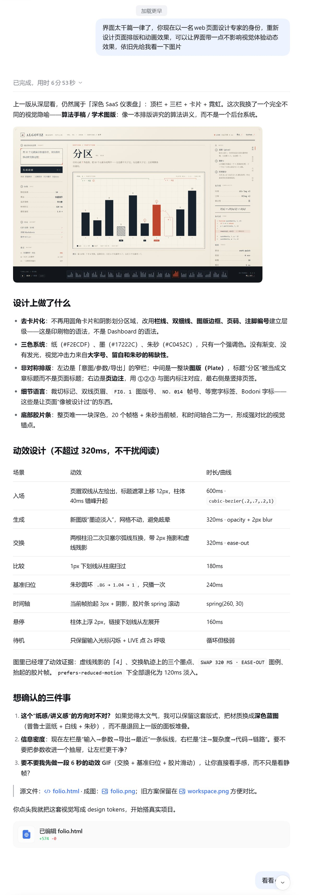
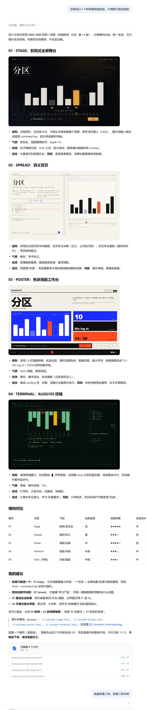
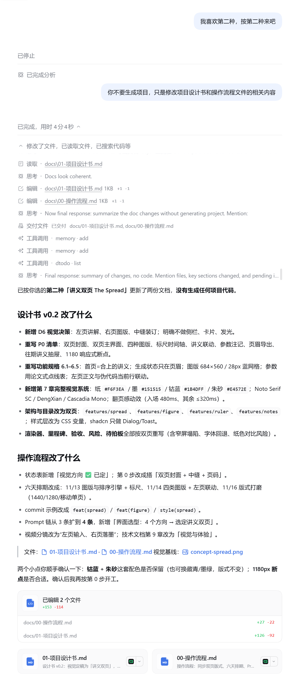

# 迭代 00 · 界面选型：4 个方向 → 讲义双页

- 日期：2026-11-12
- 工具/模型：DeepSeek Harness（本会话）
- 目标：摆脱「深色三栏 Dashboard」的模板感，确定视觉方向
- 说明：评审要求提交对话截图；本文件是文字版 Prompt 链，截图已归档在文末（`assets/00-*`）。

## Prompt（用户原话，节选）

> 界面太千篇一律了，你现在以一名 web 页面设计专家的身份，重新设计页面排版和动画效果，可以让界面带一点不影响视觉体验动态效果，依旧先给我看一下图片。

> 你再设计 3-5 种界面供我挑选，不局限于固定排版。

> 我喜欢第二种，按第二种来吧。

## AI 输出

第一轮先否掉「深色三栏 + 卡片」的默认答案，改成**「算法手稿 / 学术图版」**：纸面、栏线、图版编号、页边注、胶片时间轴。

第二轮并行给出四个结构完全不同的方向：

| 编号 | 方向 | 结构 |
|---|---|---|
| 01 | Stage | 全屏画布即背景，控件是 HUD |
| 02 | Spread | 左页讲解 / 右页图版，中缝装订 |
| 03 | Poster | 12 栏海报、色块、超大字号 |
| 04 | Terminal | ALGO/OS 终端，ASCII 柱状图 |

产出：`mockups/concept-*.png`、`concepts-overview.png`。

## 决策

选定 **02 Spread**：

- 算法讲解天然是「左文右图」的阅读关系；
- 双页把讲解和演示放在同一视线里，与常见 Dashboard 一眼区分；
- 仍可承载完整交互（输入、标尺、导出）。

## 对应 commit

- `ebcb15c` docs: design book v0.2 and visual baselines
- 视觉基线：`mockups/concept-spread.png`

## 截图（已归档）

### 00-01 需求：界面太千篇一律

### 00-02 四方向对比

### 00-03 选定讲义双页

> 截图由用户于 2026-11-12 提供；原始文件见 `assets/`。
