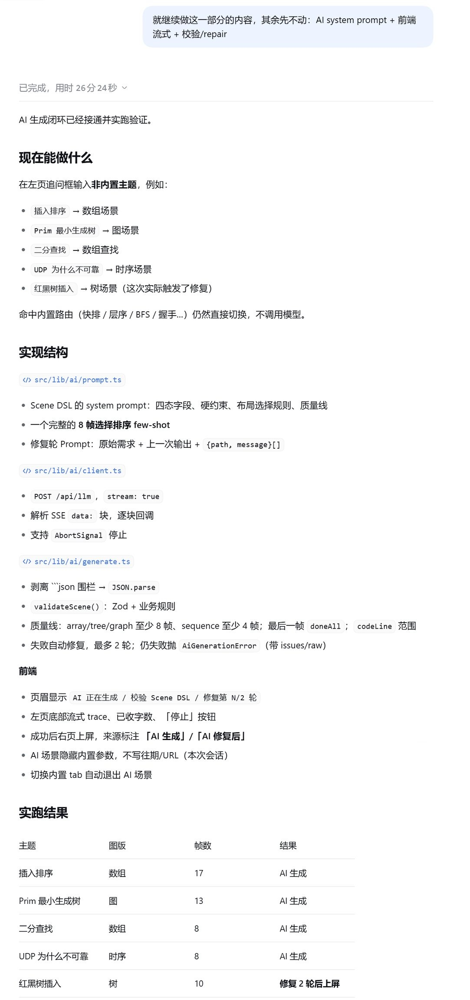
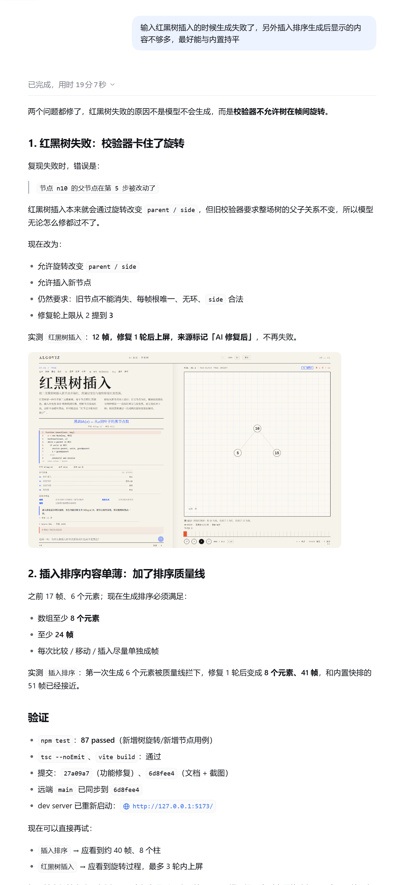
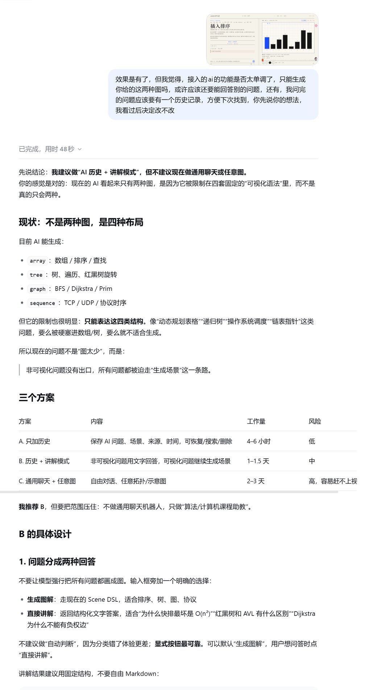
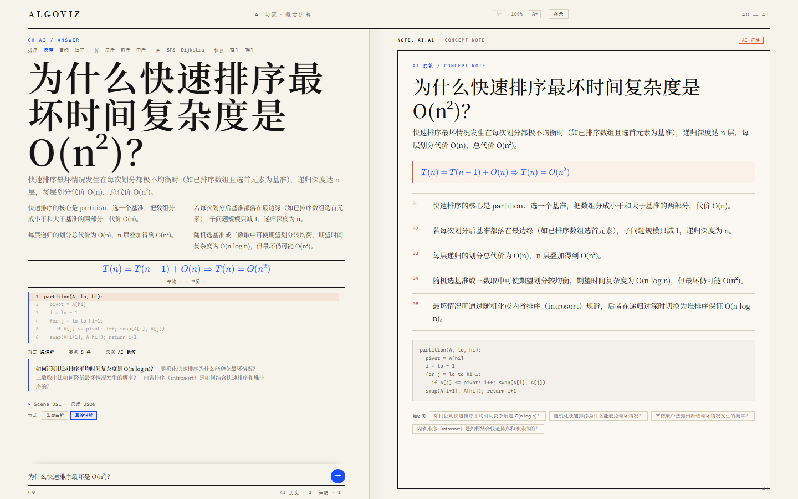
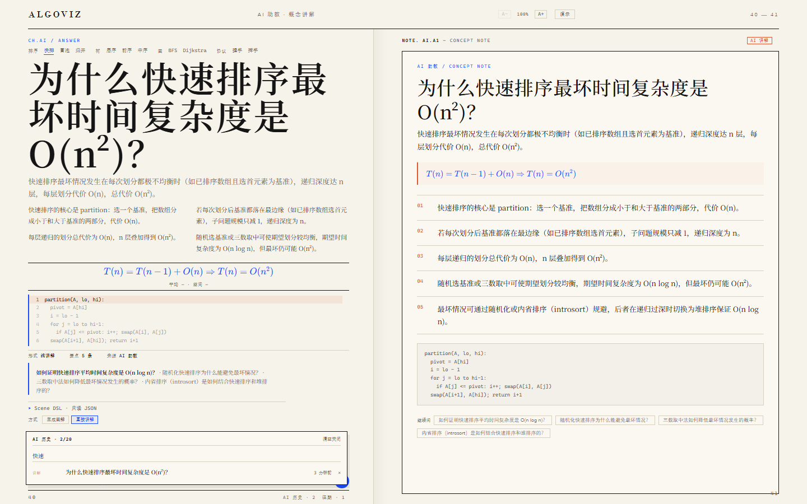

# 迭代 03 · AI 生成与校验修复（文字 + 对话截图）

- 日期：2026-11-14（生成/修复），2026-11-15（AI 历史 + 直接讲解并入）
- 工具/模型：DeepSeek Harness，`deepseek-chat`，经 `/api/llm` SSE
- 目标：非内置主题 → 流式生成 Scene DSL → 校验 → 自动修复 → 上屏；11/15 扩展 AI 历史与纯讲解
- 状态：**文字、对话截图、应用截图完成**
- 对应提交：`cee9af8`（AI 闭环）、`27a09a7`（旋转与质量线修复）、11/15 的 `feat(ai)`（历史/讲解）

> 这条链是 03 号加分项；评审硬性要求至少 3 条，00/01/02 已完成。
> 对话截图由用户提供，已裁掉无关空白；应用截图只作补充，不能替代对话截图。

## 1. 用户 Prompt

> 红黑树插入

> 插入排序

> 就继续做这一部分的内容，其余先不动：AI system prompt + 前端流式 + 校验/repair



> 第一轮 AI 闭环：system prompt、SSE、校验/repair 与 5 个实测主题。截图保留当时的快照：当时是 2 轮修复、86 tests，且 AI 场景不写历史；后续已升级为 3 轮、92 tests，并接入 AI 历史/讲解。

## 2. AI 第一次输出与问题

### 红黑树

第一次生成能解析，也能过 Zod，但过不了树业务校验：

```text
AI 生成失败：steps[5].state.nodes 节点 n10 的父节点在第 5 步被改动了；
steps[5].state.nodes 节点 n5 的父节点在第 5 步被改动了
```

原因不是模型“乱写”，而是红黑树插入本来就要旋转，旋转会改变 `parent / side`；旧校验器却要求整场树的父子关系不变。

### 插入排序

第一次生成能上屏，但只有 6 个元素、17 帧；对比内置快排 51 帧，内容明显单薄。

## 3. 修复指令（节选）

```text
树允许插入新节点、允许旋转改变 parent/side，但旧节点不能消失，
且每帧必须根唯一、无环。

排序至少 24 帧，数组至少 8 个元素；
每次比较/交换/写入单独成帧。
```

代码层对应：

- `src/lib/dsl.ts`：去掉“父节点不得变化”，保留“旧节点不可消失、根唯一、无环、side 不重复”。
- `src/lib/ai/generate.ts`：质量线按 category/layout 计算；修复轮从 2 提到 3。
- `src/lib/ai/prompt.ts`：系统提示加树旋转说明、排序 8 元素/24 帧下限、修复结构细节。

## 4. 最终结果

| 主题 | 结果 | 说明 |
|---|---|---|
| 红黑树插入 | 12 帧，AI 修复后 | 修复 1 轮；树可旋转/新增节点 |
| 插入排序 | 41 帧、8 个元素，AI 修复后 | 第一次 6 元素/17 帧被质量线拦下，修复 1 轮后扩展 |

结果截图：

- `mockups/v5-ai-repaired.png`（红黑树，12 帧，AI 修复后）
- `mockups/v5-ai-prim.png`（Prim，13 帧，AI 生成）
- `mockups/v5-ai-insertion.png`（插入排序 41 帧，AI 修复后）



> 第二段对话：用户报告“红黑树失败 + 插入排序内容不够多”，AI 定位到父节点旋转，修复后红黑树 12 帧、插入排序 41 帧，并记录验证与 commit。截图中的 87 passed 是当时的数量，后续已增至 92。

## 5. 验证

- `npm test`：92 passed（含 AI 答案/历史 4 例、树旋转/新增节点回归）
- `tsc --noEmit`、`vite build`：通过
- `/api/llm/health`：`keyConfigured: true`

## 6. 截图清单

- [x] 输入「红黑树插入」的对话界面（`assets/03-02-failure-fix.png`）
- [x] 流式生成/校验/修复的对话（`assets/03-01-implementation.jpg`、`03-02-failure-fix.png`）
- [x] 第一次校验报错（父节点被旋转，`03-02-failure-fix.png`）
- [x] 修复后的 12 帧与「AI 修复后」徽标（`03-02-failure-fix.png`）
- [x] 插入排序 41 帧结果（`03-02-failure-fix.png`）
- [x] 纯讲解问答卡（`assets/03-04-answer.png`、`mockups/v5-answer.png`）
- [x] AI 历史面板（`assets/03-05-history.png`、`mockups/v5-ai-history.png`）

> 全部截图已归档；对话截图在 `docs/prompts/assets/03-01..03-03`，应用截图在 `03-04..03-05` 与 `mockups/`。

## 7. 11/15 扩展：AI 历史 + 直接讲解

### 用户 Prompt

> 为什么快速排序最坏是 O(n²)？



> 方案讨论：用户提出“功能太单调、还要能回答别的问题、需要历史记录”，AI 给出 A/B/C 三种方案，推荐 B（AI 历史 + 直接讲解），并把范围压到“算法课程助教”。

### AI 输出

模型返回结构化 `answer`：

- 标题：为什么快速排序最坏时间复杂度是 O(n²)？
- 结论：每次划分极不均衡时递归深度退化为 n，总代价 O(n²)。
- 5 条要点：分区代价、极端基准、逐层累加、随机/三数取中、`introsort` 兜底。
- 公式：`T(n)=T(n-1)+O(n) => T(n)=O(n²)`
- 代码：Lomuto `partition`
- 4 条追问：递推证明、随机基准、三数取中、`introsort`

### 实现

- `src/lib/ai/answer.ts`：`answerSchema`（title/summary/3–5 points/formula/code/followups）+ 最多 2 轮修复 + `answerToScene()`（左页复用 Scene 排版）。
- `src/components/AnswerCard.tsx`：右页纯讲解卡；不再画动画图版，不显示标尺/帧号。
- `src/lib/ai/history.ts`：`algoviz:ai-history:v1`，最多 20 条，保存 prompt/scene/answer/source/mode/title；按 prompt+mode 去重；`#ai=<id>` 恢复。
- `src/App.tsx`：显式「生成图解 / 直接讲解」切换；历史面板支持搜索、恢复、删除、清空；刷新可恢复。

### 验证

- 纯讲解：右页问答卡 5 条要点 + 公式 + 代码 + 4 条追问；左页讲义排版复用。
- 刷新：URL 保持 `#ai=<id>`，页面恢复答案。
- 历史：2 条记录（图解 + 讲解），搜索「快速」只留讲解；点击恢复成功。
- 截图：`mockups/v5-answer.png`、`mockups/v5-ai-history.png`。
- 测试：`npm test` 92 passed。





> 应用截图用于展示最终效果；对话截图（03-01..03-03）才是 AI 协同过程的证据。
