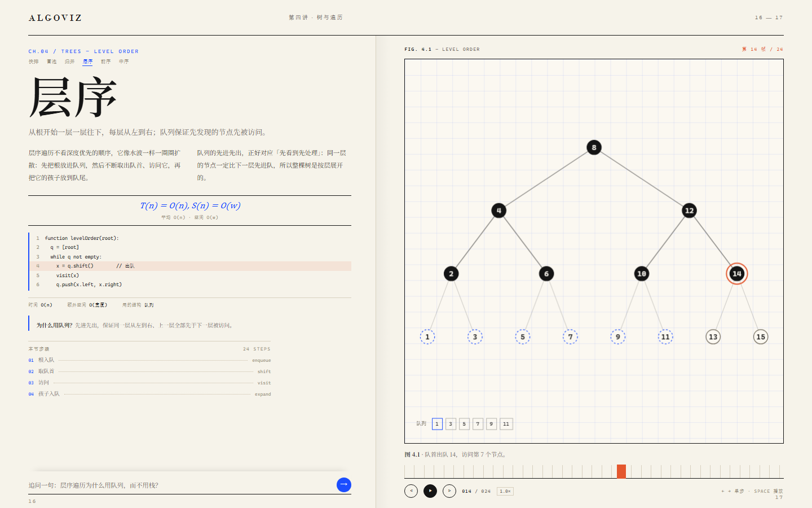
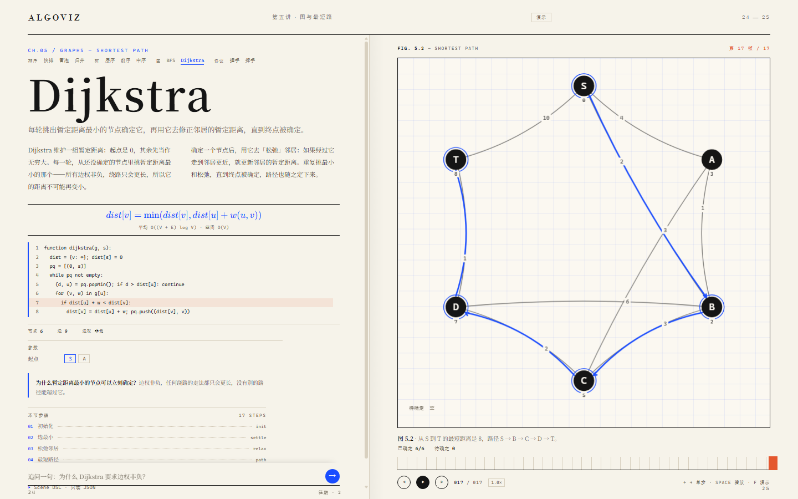
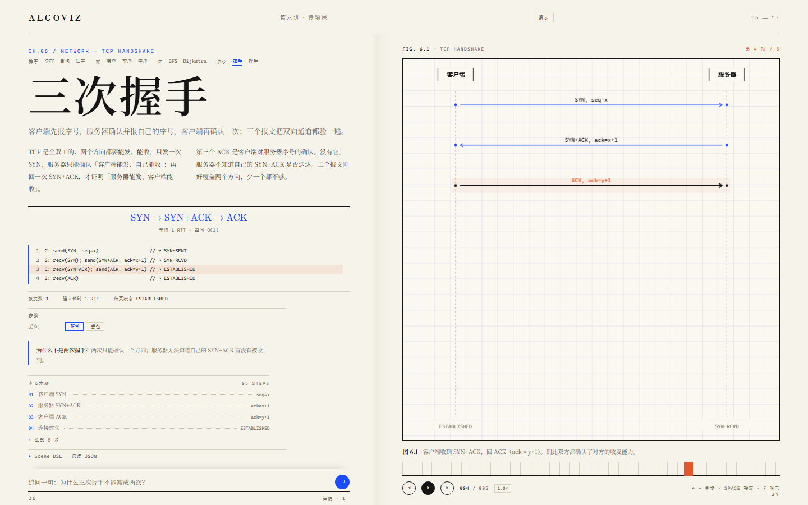
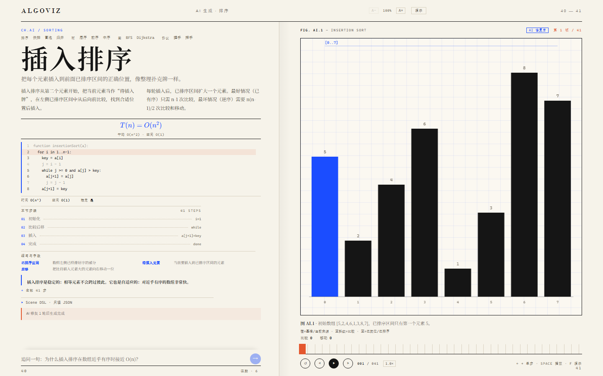
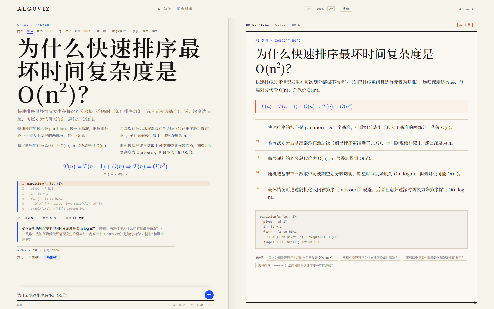
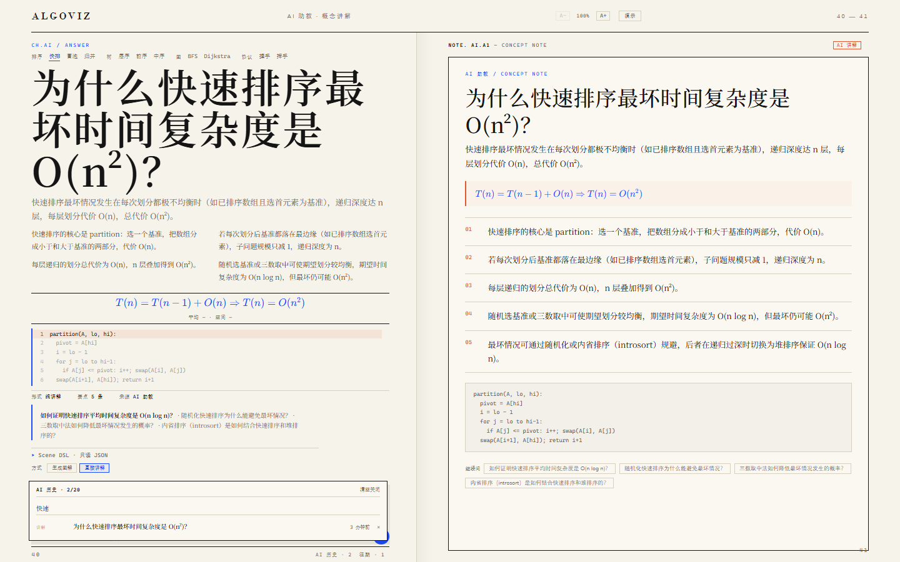

# 1 项目详情

## 1.1 一句话

**说一句原理，生成一段可单步、可调参、可复现的算法动画。**

AlgoViz（算法视界）是一个面向计算机 / 理工科学生、考研复习者、助教与课堂演示者的算法可视化工作台。它把「快速排序怎么跑」「TCP 三次握手长什么样」这类抽象过程，从一段文字变成一页可交互、可回溯、可讲解的算法讲义：左页是正文、公式与伪代码，右页是能播放、能单步、能拖动的图版。

作品形式是 Web 应用（React + TypeScript + Vite），仓库公开在 GitHub，本地一条命令即可运行，不依赖数据库与账号体系。

## 1.2 解决什么问题

算法课里最难的往往不是记住结论，而是理解过程：

- 学生看静态图，知道快排要分区，却不知道指针每一步怎么移动；
- 看伪代码能背出 Dijkstra 的松弛，却无法把「待确定集合」和路径变化对应起来；
- TCP 三次握手背得出 SYN / ACK，却说不清为什么两次不够、丢包后谁重传；
- 老师做课堂演示，要在 PPT、代码、动画网站之间来回切换，学生注意力被切碎。

现有方案各有缺口：静态教材过程不可见；题库式可视化网站只覆盖固定题目；通用聊天机器人给文字和代码，但不是可逐帧核对的过程；手工做动画成本太高，课堂临时需求来不及。

AlgoViz 的做法是：**不生成一次性视频，而生成一份结构化、可校验、可复现的 Scene DSL**，再由确定性渲染器画出来。常用主题走内置引擎，零延迟、断网可用；长尾主题走大模型，生成、校验、修复后上屏。

## 1.3 已实现与未实现

| 能力 | 状态 |
|---|---|
| 10 个内置场景、4 类图版（数组 / 树 / 图 / 时序） | ✅ 已实现 |
| 参数注记、过程量、点伪代码跳帧、大纲跳转、四档投影字号、板书模式 | ✅ 已实现 |
| AI 流式生成 → 三层校验 → 最多 3 轮修复 → 上屏 | ✅ 已实现 |
| AI 历史（20 条、搜索 / 恢复 / 删除）与「直接讲解」问答卡 | ✅ 已实现 |
| 只读 Scene DSL JSON 抽屉、URL 深链、刷新恢复 | ✅ 已实现 |
| 导出 PNG / GIF / Markdown / 教学卡片 | ⬜ 未实现（后续计划） |
| 账号、云同步、多人协作 | ⬜ 不做（不在作品范围） |

# 2 使用方式

## 2.1 本地运行

环境要求：Node 20.19+、npm 11+。仓库已带 lockfile，推荐 `npm ci`。

```bash
git clone https://github.com/Hyas-spec/AlgoViz-Studio.git
cd AlgoViz-Studio
npm ci
cp .env.local.example .env.local   # 仅 AI 生成需要，填 LLM_API_KEY；内置场景可跳过
npm run dev                        # http://127.0.0.1:5173
npm test                           # 92 个用例
```

`.env.local.example` 里已经给出 `LLM_BASE_URL`、`LLM_API_KEY`、`LLM_MODEL` 三项模板，Key 只在 Node 侧读取，不会进入浏览器。完整步骤与常见问题见仓库 `README.md`。

## 2.2 三步上手

1. **选一个场景**：页眉下方按「排序 / 树 / 图 / 协议」四组切换，或直接在左页输入框输入一句话。
2. **看过程**：右页图版播放；拖底部标尺跳帧，点左页伪代码跳到对应行，点大纲跳关键阶段。
3. **改参数**：左页参数表改数组规模、基准策略、树高、图起点、TCP 丢包开关，图版即时重算。

## 2.3 十个内置场景

| 场景 | 图版 | 默认步数 | 可调参数 |
|---|---|---|---|
| 快速排序 | 数组 | 51 | n 4–16、基准末元素 / 三数取中 |
| 冒泡排序 | 数组 | 72 | n 4–12 |
| 归并排序 | 数组 | 78 | n 4–12，含左右辅助段 |
| 层序遍历 | 树 | 24 | 树高 3–4 层 |
| 前序遍历 | 树 | 31 | 树高 3–4 层 |
| 中序遍历 | 树 | 39 | 树高 3–4 层 |
| BFS | 图（环形） | 15 | 起点 A / D |
| Dijkstra | 图（环形） | 17 | 起点 S / A |
| TCP 三次握手 | 时序 | 5（丢包 6） | 正常 / 丢包 |
| TCP 四次挥手 | 时序 | 6（丢包 7） | 正常 / 丢包 |

## 2.4 AI 生成与直接讲解

- 命中内置关键词的主题（快排、层序、BFS、握手…）直接切换，0 延迟；
- 没命中的主题（插入排序、Prim、二分查找、红黑树、UDP…）走 `/api/llm` 流式生成，页眉显示阶段，左页底部显示流式 trace 与「停止」；
- 生成结果先经过 JSON 解析、Zod 结构校验、业务规则与质量线，不合格自动修复，最多 3 轮；成功后标注「AI 生成」或「AI 修复后」；
- 输入区可显式切换「直接讲解」，把概念问题变成右页问答卡（结论、3–5 条要点、公式、代码、追问），不冒充动画。

## 2.5 课堂演示技巧

- 页眉 `A−` / `A+` 调四档投影字号（100 / 112 / 126 / 142%），画布节点标签同步放大；
- `F` 进入板书模式，隐藏左页、图版铺满，`Esc` 退出；
- 把某一帧的 URL 收藏下来（`?scene=quick&size=8&step=12`），上课直接跳到该帧；
- 图注下方有图例与过程量（比较 / 交换 / 已就位），讲复杂度时可以直接指着说。

# 3 项目亮点

1. **不是「套壳聊天」，而是受约束的生成**：模型只输出 Scene DSL，不碰坐标、不执行代码；Zod + 业务规则 + 质量线三层校验，失败结构化回喂，最多 3 轮修复。这让 AI 的失败可解释、可修复。
2. **双轨生成，课堂不断线**：10 个内置场景由确定性引擎生成，断网、无 Key 也能演示；AI 只负责长尾主题，成本与失败率可控。
3. **讲义双页的视觉语言**：左文右图、中缝装订、纸 / 墨 / 钴蓝 / 朱砂四色，和常见的深色 Dashboard 一眼区分；四档投影字号让后排也看得清。
4. **教学过程可核对**：点伪代码跳帧、拖标尺、过程量、图例、只读 JSON 抽屉——学生不只看动画，还能核对「第 12 帧到底改了什么」。
5. **可复现性写进产品**：内置场景同参数同结果；URL 参数即状态；AI 场景存历史、`#ai=<id>` 刷新恢复；JSON 可快照、可 diff。
6. **工程证据完整**：仓库 60 余个细粒度提交、4 条 Prompt 链（含对话截图与失败修复）、92 个单元测试、10 分钟复现指南。

# 4 AI 技术落地使用情况概述

> 本节同时说明两件事：开发过程如何用 AI 完成（Vibe Coding），以及产品内部如何把 AI 做成可用功能、如何测试它的输出质量。

## 4.1 工具与模型

- 开发工具：DeepSeek Harness（DSH）作为 AI 编程代理，负责从脚手架到功能迭代的主要实现；
- 产品内模型：DeepSeek-Chat（OpenAI 兼容接口），经 Vite 中间件 `/api/llm` 以 SSE 流式调用；
- 关键约束：Key 只在服务端；温度 0.15；单次生成约 4k–8k token。

## 4.2 AI 参与的范围

| 阶段 | AI 做了什么 | 人工判断 / 验收 |
|---|---|---|
| 界面选型 | 给出 Stage / Spread / Poster / Terminal 四个方向与取舍 | 选定「讲义双页」，确定纸 / 墨 / 钴蓝 / 朱砂 |
| 脚手架 | Vite + React + TS 工程、双页首屏、响应式与兼容性修复 | 逐屏走查 1920 / 1440 / 1024 / 390 |
| 引擎与 DSL | Scene DSL v2、三种排序、三种遍历、BFS / Dijkstra、TCP 时序 | 92 个测试、手工 QA、10 场景回归 |
| AI 闭环 | system prompt、SSE 客户端、校验 / 修复、质量线 | 5 个主题实测、修复轮数记录 |
| 讲解与历史 | answerSchema、问答卡、localStorage 历史、`#ai=` 恢复 | 历史恢复、搜索、刷新恢复验证 |
| 文档与视频 | 设计书、交付台账、技术文档、视频脚本与台词 | 逐条核对与修改 |

## 4.3 如何指挥 AI：四条 Prompt 链

仓库 `docs/prompts/` 保留 4 条完整链，每条都记录用户原话、AI 建议、失败、修复指令、结果与对应 commit：

- **00 界面选型**：4 个方向对比 → 选定讲义双页 → 确定设计令牌；
- **01 脚手架与双页**：首屏实现 → 兼容性问题 → fluid 布局修复；
- **02 引擎与三种排序**：DSL 设计 → 三排序 → 四态扩展 → 参数与过程量；
- **03 AI 生成与修复**：生成闭环 → 红黑树校验失败 → 放宽树旋转规则 → 修复上屏 → AI 历史与直接讲解。

## 4.4 一个真实的「引导修复 Bug」案例

输入「红黑树插入」后，第一次生成能解析、能过 Zod，却过不了树业务校验：

```text
steps[5].state.nodes 节点 n10 的父节点在第 5 步被改动了
```

定位后发现：红黑树插入本来就要旋转，旋转必然改变 `parent / side`；旧校验器却要求整场树的父子关系不变，模型无论怎么修都过不了。

修复动作分三步：把校验规则改为「允许旋转 / 新增节点，但旧节点不消失、每帧根唯一、无环」；把修复轮从 2 提到 3；把树旋转说明写进 system prompt。修复后红黑树 12 帧、修复 1 轮上屏，插入排序也从 6 元素 / 17 帧扩展到 8 元素 / 41 帧。

完整的失败与修复对话截图见仓库 `docs/prompts/assets/03-02-failure-fix.png`，以及技术文档第 5.4 节。

## 4.5 AI 输出质量的测试方法

- **结构测试**：Zod Schema 覆盖四态字段、枚举、数量上限；
- **业务测试**：根唯一、无环、悬空边、泳道引用、数组越界、重复 dist；
- **质量线**：排序 ≥24 帧且 8 元素、树 ≥12 帧、图 ≥10 帧、时序 ≥5 帧、末帧 `doneAll`；
- **回归集**：10 条 AI Prompt 实测 9/10 上屏；选择排序 1 次 JSON malformed，3 轮修复未收敛，作为已知边界记录；
- **单元测试**：92 例，其中 AI 相关覆盖 JSON 提取、few-shot 校验、修复轮、质量线、答案 schema、历史读写。

## 4.6 量化结果

| 指标 | 数值 |
|---|---|
| 仓库提交 | 60 余个细粒度提交（2026-11-12 至 11-16） |
| 内置场景 | 10 个，4 类图版 |
| AI 实测主题 | 插入排序 41 帧、红黑树 12 帧、Prim 13 帧、二分查找 8 帧、UDP 8 帧 |
| 测试 | 92 例通过；`tsc --noEmit` 通过 |
| 构建 | 674.38 KB raw / 207.13 KB gzip |
| Prompt 链 | 4 条，均含对话截图 |

# 5 关键技术

## 5.1 技术栈

| 层 | 选型 | 理由 |
|---|---|---|
| 前端框架 | React 19 + TypeScript strict | 组件化、类型安全；场景规模小，不引入额外状态库 |
| 构建 | Vite 8 | 启动快，dev / preview 共用中间件 |
| 校验 | Zod 4 + 自写业务校验 | 结构校验与业务规则分离，错误可回喂 |
| 渲染 | Canvas 2D（四个渲染器） | 坐标确定性计算，同一份 JSON 同一画法 |
| 公式 | KaTeX | 讲义里的复杂度与递推式 |
| 测试 | Vitest | 引擎、校验、AI 解析 / 修复 / 质量线 |
| 代理 | Vite middleware `/api/llm` | Key 只在 Node 侧，SSE 透传 |

## 5.2 Scene DSL 与三层校验

Scene 由「元数据 + Step 数组」组成，每个 Step 的状态是 array / tree / graph / sequence 四态判别联合。所有字段都有上限：步数 ≤120、树节点 ≤31、图节点 ≤20、时序消息 ≤12。

校验分三层：Zod 管结构与类型；`inspectScene()` 管业务规则（根唯一、无环、悬空边、数组越界、泳道引用）；`qualityIssues()` 管教学质量（帧数、元素数、末帧 `doneAll`、`codeLine` 范围）。任何一层失败都返回 `{path, message}[]`，既显示在 trace 里，也回喂模型修复。

## 5.3 四个确定性渲染器

- 数组：墨色柱、下标、朱砂基准、蓝色斜纹比较、归并左右辅助段；
- 树：纸面层序布局、细线连边、当前节点朱砂圈、队列 / 栈游标；
- 图：环形布局、二次曲线边、边权、Dijkstra 暂定距离、最短路蓝线；
- 时序：泳道生命线、消息箭头、丢包断箭与「重传」。

模型只给拓扑与顺序，坐标、字号、间距由渲染器计算，因此 1440、1024 与手机宽度下都能保持可读。

## 5.4 生成质量保障

生成结果要过三道闸门：JSON 可解析 → Zod 结构合法 → 业务与质量线合格。失败进入修复，最多 3 轮，每轮带上一轮的具体 issues；差一错误（`outline.step` 越界）直接夹取，不浪费一轮。3 轮仍失败则保留当前场景、显示错误摘要、trace 保留原始输出，不写历史、不写 URL。

## 5.5 可复现性

- 内置引擎是纯函数：同参数 → 同 Scene、同帧序列；
- 场景是 JSON：可快照、可 diff、可在只读抽屉里核对；
- URL 即状态：`?scene=&step=&size=&pivot=&levels=&start=&loss=`；
- AI 历史：localStorage 20 条 + `#ai=<id>` 刷新恢复；
- 干净目录：`npm ci` → 92 测试 → build → dev 页面 200，2026-11-16 实测通过。

# 6 项目相关图片

{width=14.5cm}

{width=14.5cm}

{width=14.5cm}

{width=14.5cm}

{width=14.5cm}

{width=14.5cm}

# 7 发表与获奖情况

本项目为本次比赛期间（2026-11-12 至 11-18）原创开发的作品，**此前未公开发表、未参加其他赛事、未获得任何奖项**，也未申请专利或软件著作权。

仓库自 2026-11-12 建立，提交历史完整可查；技术文档、作品介绍文档、演示视频均为本次提交专门制作。

# 8 是否基于其他项目优化

**不是。** 本项目从零搭建，没有 fork、复制或二次开发任何既有项目；仓库的第一个提交是脚手架，此后按功能逐日演进（界面选型 → 双页版式 → DSL 与排序 → 树 / 图 / 时序 → AI 生成与修复 → 历史与讲解）。

开发中使用了以下开源库，均通过 npm 正常引入，未修改其源码：

| 依赖 | 用途 |
|---|---|
| React / React DOM | 界面 |
| Vite | 构建与 dev / preview 中间件 |
| Zod | Scene 结构校验 |
| KaTeX | 公式渲染 |
| Vitest | 单元测试 |
| TypeScript | 类型系统 |

与常见的「题库式算法可视化网站」相比，本项目的差异在于：场景由自然语言生成、输出是受约束的 DSL、生成结果有校验与修复闭环，而不是预先写死的固定演示。

# 9 交付物与链接

| 交付物 | 位置 |
|---|---|
| 源码仓库（Public） | https://github.com/Hyas-spec/AlgoViz-Studio |
| 10 分钟复现指南 | 仓库 `README.md` |
| Prompt 链 00–03（含截图） | 仓库 `docs/prompts/` |
| 技术文档（≤30 页 PDF） | 提交材料包 `01-AlgoViz-技术文档.pdf` |
| 演示视频（6 分 29 秒，1080p） | B 站公开链接（见提交表单） |
| 完整材料包 | 网盘链接（见提交表单） |
