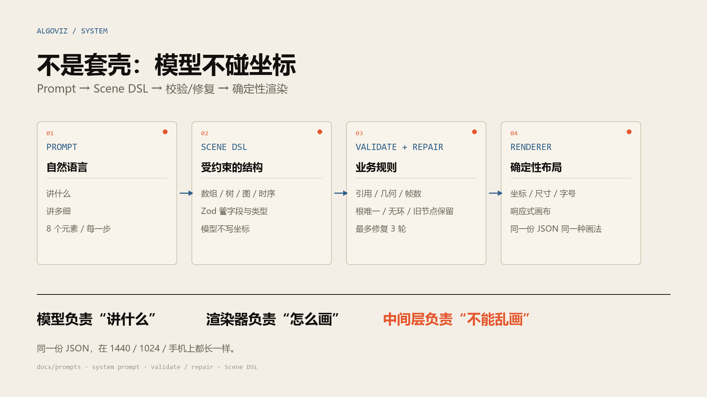
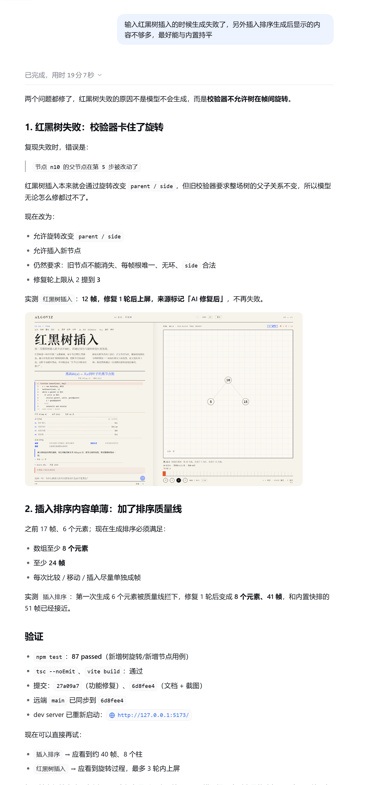
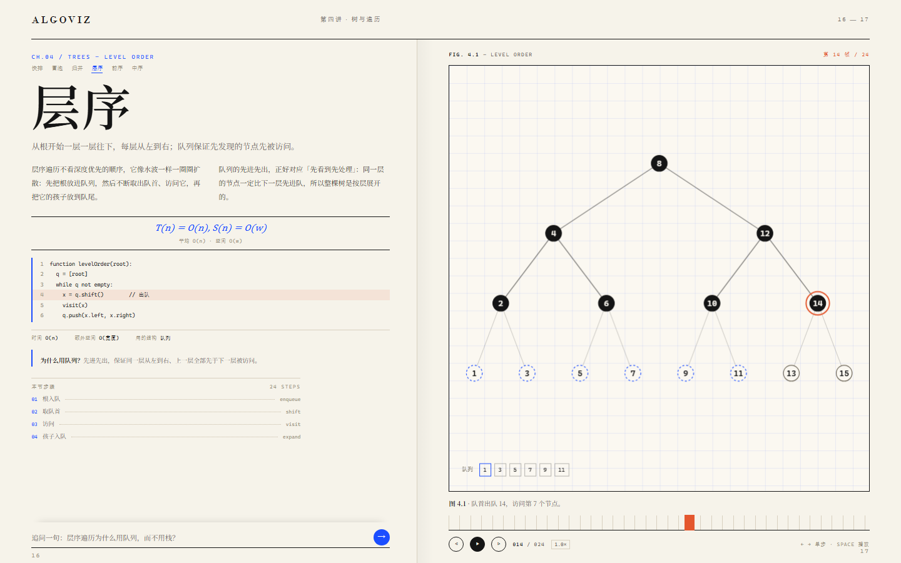
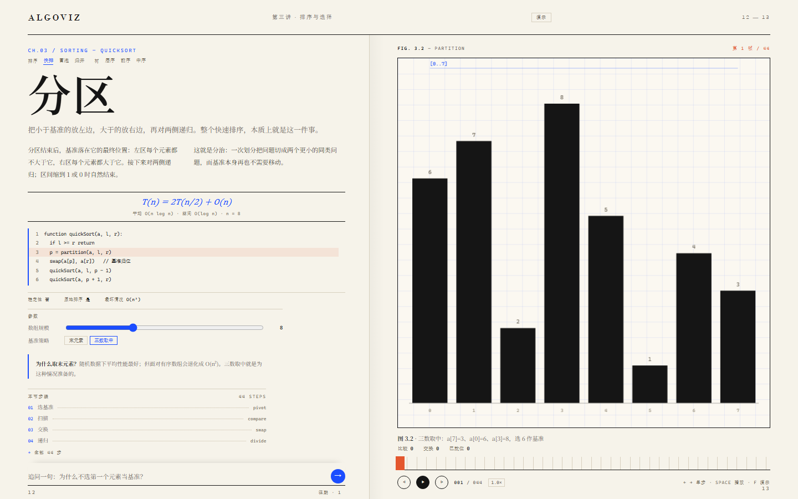
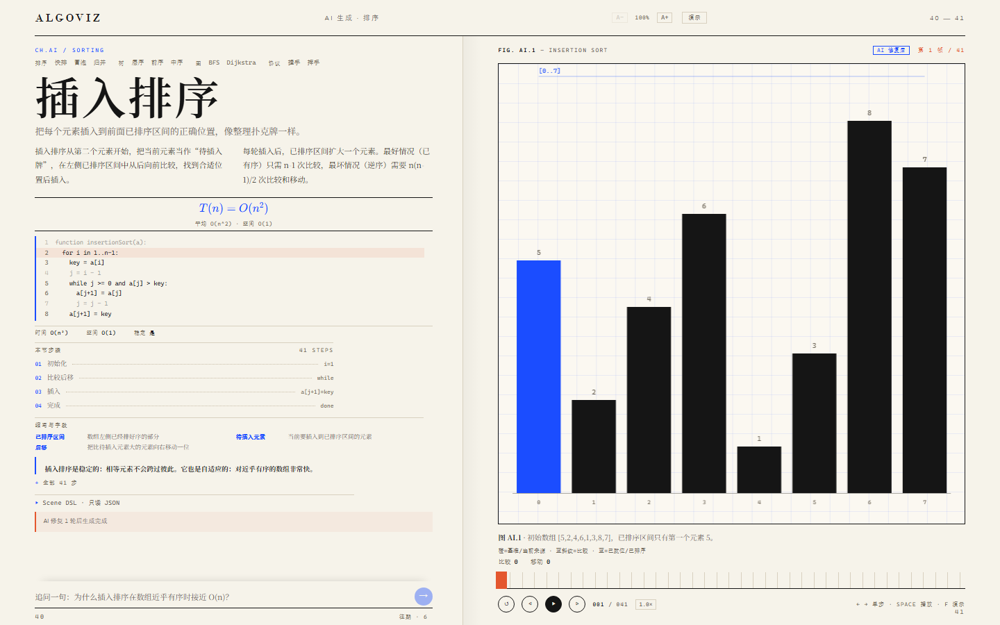
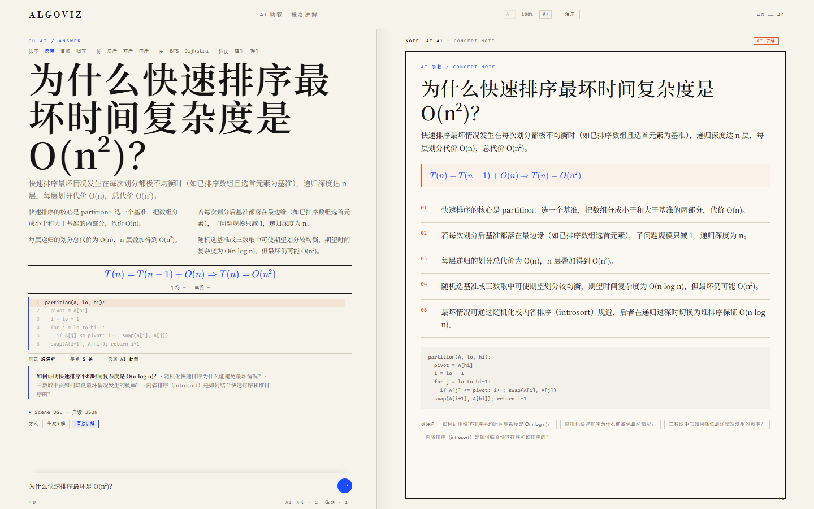

# 摘要

本项目面向计算机与理工科学生、考研复习者、助教与课堂演示者，解决一个具体问题：算法与协议的「过程」看不见。教材给结论，代码给结果，通用聊天机器人给文字——学生仍然要在脑子里补出指针怎么移动、队列怎么扩张、丢包之后谁重传。

AlgoViz 把一句自然语言描述转换成一份结构化的 Scene DSL，再由四个确定性渲染器画成可单步、可回退、可调参、可回放的算法讲义。系统有两条生成路径：常用主题走内置引擎，零延迟、断网可用；长尾主题走大模型，流式生成 JSON，经 Zod 结构校验、业务规则校验与教学质量线检查后上屏，不合格的输出回喂模型自动修复，最多 3 轮。模型只负责「讲什么」，渲染器负责「怎么画」，中间层负责「不能乱画」——这是本项目与「套壳聊天」的核心区别。

当前版本已实现 10 个内置场景、4 类图版、AI 生成与修复闭环、AI 历史与直接讲解，92 个单元测试全部通过；仓库有 60 余个细粒度提交，Prompt 链 00–03 均保留对话截图与修复记录。本文档重点说明三件事：意图控制策略（第 5 章）、架构设计与约束方式（第 2–4 章）、可复现性论证（第 7 章）。

**关键词**：算法可视化；Scene DSL；大模型生成；意图控制；可复现性

全文共 10 章：第 1–2 章说明问题与方案，第 3–4 章说明架构与 DSL，第 5–6 章说明提示词设计与质量保障，第 7–8 章说明可复现性与测试，第 9–10 章说明体验、边界与后续路线；附录给出交付物索引与复现检查清单。

# 1 选题与痛点

## 1.1 谁的问题

算法与数据结构课程里，最难的往往不是记住结论，而是理解过程。以下四类场景反复出现：

- 学生看静态图，知道快速排序要分区，却不知道指针每一步怎么移动、基准什么时候归位；
- 看伪代码能背出 Dijkstra 的松弛操作，却无法把「待确定集合」与路径变化对应起来；
- TCP 三次握手背得出 SYN / ACK，却说不清为什么两次不够、丢包之后由谁重传；
- 老师做课堂演示，要在 PPT、代码编辑器、动画网站之间来回切换，学生注意力被切碎。

这些问题有一个共同点：**缺的不是知识条目，而是可核对的过程**。学生需要的不只是「快排平均 O(n log n)」这句话，而是第 7 帧时 i 和 j 分别指向哪里、为什么这次交换发生。

## 1.2 现有方案的不足

| 方案 | 优点 | 不足 |
|---|---|---|
| 静态教材 / PPT | 结构清楚、可打印 | 过程不可见，学生只能脑补 |
| 题库式可视化网站 | 常见算法覆盖好、交互成熟 | 只覆盖固定题目，长尾主题无法生成 |
| 通用聊天机器人 | 能解释概念、能写代码 | 给出的是文字或代码，不是可逐帧核对的过程 |
| 手工制作动画 | 完全可控、质量高 | 成本高，课堂临时需求来不及 |

因此，本项目不把「生成一段动画」做成一次性视频，而是生成一份**结构化、可校验、可复现的 Scene DSL**：它是数据，不是脚本；可以被渲染、被校验、被存档、被 diff，也可以被评委在 JSON 抽屉里逐字段核对。

## 1.3 目标与边界

项目的目标可以压缩成一句话：**说一句原理，生成一段可单步、可调参、可复现的算法动画。**

对应的边界同样明确：

- 只支持四种可视化语法（数组、树、图、时序），不试图画任意示意图；
- 不执行 AI 生成的代码，AI 只输出 JSON；
- 不做账号体系与云端同步，本地持久化即可满足课堂与复习场景；
- 导出（PNG / GIF / Markdown）列为后续增强，不阻塞本次提交。

# 2 方案与创新

## 2.1 双轨生成

系统有两条生成路径，入口是同一句自然语言：

1. **内置引擎**：排序、树遍历、BFS / Dijkstra、TCP 握手 / 挥手等 10 个场景由确定性代码生成。命中关键词直接切换，0 延迟、断网可演示、参数改动即时重算。
2. **AI 生成**：未命中的长尾主题走 `/api/llm`，流式生成 Scene DSL，再经过结构、业务与质量三层校验；失败自动修复。

内置引擎保证「常用场景永远能演示」，AI 保证「没见过的主题也有机会生成」。纯 AI 方案在课堂断网或模型抖动时不可用；纯题库方案无法覆盖「红黑树插入」这类长尾主题。双轨是可用性与覆盖率之间的折中。

## 2.2 三个关键取舍

- **模型不生成坐标**：坐标由 array / tree / graph / sequence 四个确定性渲染器计算，避免节点重叠、越界与分辨率不一致。模型只给拓扑与顺序。
- **模型只输出 JSON**：不执行 AI 生成的代码，不 `eval`、不 `new Function`，攻击面小；输出可被程序理解、被 Schema 约束。
- **先校验再上屏**：Schema、业务规则、质量线三层检查，不合格的 JSON 不进入画布；失败带 `path + message`，既回喂模型，也显示在 trace 中。

{width=15cm}

## 2.3 与「套壳聊天」的边界

普通聊天应用把模型输出直接显示给用户；本项目的输出必须同时满足四类约束：

- 属于四类图版之一，字段与枚举符合约定；
- 节点、边、数组下标、泳道与消息的引用完整；
- 帧数、终态、代码行范围达到教学质量线；
- 能被渲染器稳定绘制，能被只读 JSON 抽屉核对。

| 对比维度 | 套壳聊天应用 | AlgoViz |
|---|---|---|
| 输出形态 | 自由文本、代码块 | 受 Schema 约束的 Scene DSL |
| 错误发现 | 用户自己看出来 | Zod + 业务规则 + 质量线三层自动校验 |
| 失败处理 | 让用户重新提问 | 结构化 issues 回喂，最多 3 轮自动修复 |
| 绘制方式 | 无 | 四个确定性渲染器，同一份 JSON 同一画法 |
| 过程复现 | 依赖对话记录 | JSON 快照、URL 参数、AI 历史深链 |
| 过程证据 | 聊天截图 | Prompt 链 + commit + 测试 + 截图 |

AI 在这个系统里是「讲义作者」，不是「画布操作者」。这决定了它的失败是可解释、可修复的，而不是一段无法验证的文本。

# 3 系统架构

## 3.1 总体结构

系统是单页应用加一个轻量代理，没有数据库、没有账号体系：

```text
浏览器
  ├─ 双页界面（左讲义 / 右图版 / 标尺 / 页眉页脚）
  ├─ 规则路由 routeScene ──命中──► 内置引擎（纯函数）──► Scene
  ├─ 未命中 ──► generateScene ──► POST /api/llm (SSE)
  │                                  │
  │                                  ▼
  │                            extractJson → validateScene → qualityIssues
  │                                  │  失败：issues 回喂，最多 3 轮
  │                                  ▼
  │                            Scene ──► Figure / 讲义 / JSON 抽屉
  └─ localStorage：AI 历史（20 条）+ #ai=<id> 恢复
Vite middleware /api/llm ──► OpenAI 兼容上游（Key 只在 Node 侧）
```

## 3.2 前端

- React 19 + TypeScript strict + Vite 8；
- 状态用 `useState` / `useMemo`，场景规模小，不引入额外状态库；
- 双页版式：左页讲义，右页图版；CSS 变量控制纸 / 墨 / 钴蓝 / 朱砂四色；
- 四个 Canvas 2D 渲染器：`figure/array.ts`、`tree.ts`、`graph.ts`、`sequence.ts`，共用 `Figure` 的调度接口；
- KaTeX 渲染 `Scene.formula`；`JsonDrawer` 提供只读 DSL 核对；
- AI 历史存 `localStorage`，最多 20 条，`#ai=<id>` 刷新可恢复。

## 3.3 服务端与密钥边界

`/api/llm` 是 Vite 中间件，dev 与 preview 共用：只接受 OpenAI 兼容的 `{ messages, model, temperature, max_tokens, stream }`，把请求转发给上游并透传 SSE。`LLM_API_KEY` 只存在于 `.env.local`，不进入浏览器代码，也不出现在响应里。健康检查 `GET /api/llm/health` 返回 `{ ok, keyConfigured, model }`，用于录制前确认环境。

这一层刻意做得很薄：它不理解 Scene，也不做业务判断，只解决「密钥不能下发到浏览器」这一件事。所有生成逻辑与校验逻辑仍在前端，方便评审逐行核对。

<!-- pagebreak -->

## 3.4 目录结构

```text
src/
  App.tsx                 双页界面、状态机、AI 生成/讲解/历史
  lib/dsl.ts              Scene DSL、Zod Schema、业务校验 inspectScene
  lib/engines/            快排 / 冒泡 / 归并 / 树遍历 / BFS / Dijkstra / TCP
  lib/ai/prompt.ts        system prompt、few-shot、布局选择规则
  lib/ai/client.ts        SSE 解析与中止
  lib/ai/generate.ts      JSON 提取 → 校验 → 质量线 → 修复轮
  lib/ai/answer.ts        直接讲解的 schema、修复与排版转换
  lib/ai/history.ts       localStorage 历史与 #ai= 恢复
  components/figure/      array / tree / graph / sequence 四个渲染器
  components/             AnswerCard、Formula、JsonDrawer、ErrorBoundary
server/llmProxy.ts        /api/llm 代理（Key 只在服务端）
```

评审可以按这份目录直接定位证据。几个关键文件与职责如下：

| 文件 | 职责 | 对应章节 |
|---|---|---|
| `lib/dsl.ts` | Scene 类型、Zod Schema、业务校验 `inspectScene()` | 第 4 章 |
| `lib/ai/prompt.ts` | system prompt、few-shot、布局与质量线规则 | 第 5 章 |
| `lib/ai/generate.ts` | JSON 提取、三层校验、≤3 轮修复 | 第 6 章 |
| `lib/engines/` | 排序 / 树 / 图 / 时序四类内置引擎（纯函数） | 第 7 章 |
| `components/figure/` | 四个 Canvas 渲染器，坐标由渲染器计算 | 第 9 章 |
| `server/llmProxy.ts` | `/api/llm` 代理，Key 只留在 Node 侧 | 第 3 章 |

# 4 Scene DSL

## 4.1 为什么需要中间层

如果让模型直接生成 SVG、Canvas 指令或 React 代码，会同时失去三件事：可校验（无法判断「这棵树有没有环」）、可复现（每次输出都是新程序）、可解释（失败时只能说「画不出来」）。Scene DSL 把「讲什么」与「怎么画」分开：模型描述状态与顺序，渲染器负责几何与动效。

## 4.2 Scene 与 Step

```ts
interface Step {
  caption: string;      // ≤80 字，当前步的旁白
  codeLine: number;     // 对应伪代码行
  metrics?: { label: string; value: string }[];  // 过程量，如比较/交换
  doneAll?: boolean;    // 是否终态
  state: ArrayState | TreeState | GraphState | SequenceState;
}
```

`Scene` 还包含标题、章节、摘要、正文、公式、复杂度、伪代码、事实表、大纲、参数、来源等字段。所有字段都有上限：`steps.length ∈ [1, 120]`、`caption ≤ 80`、树节点 ≤ 31、图节点 ≤ 20、时序消息 ≤ 12。

## 4.3 四态联合

| 状态 | 关键字段 | 校验重点 |
|---|---|---|
| array | values、pivot、compare、swap、locked、range、aux | 下标与区间合法、交换元素存在、辅助段指针不越界 |
| tree | nodes（id / label / parent / side）、order、current、frontier | 根唯一、父节点存在、无环、side 不重复 |
| graph | nodes、edges、visited、frontier、path、current、dist | 边端点存在、无自环、dist 引用不重复 |
| sequence | lanes、messages（from / to / label / tone / lost）、active、notes | 泳道 ≥ 2、消息端点属于泳道、消息 id 不重复 |

四种状态共用 `Figure` 的调度接口，渲染器按层序、环形、泳道等规则自行计算坐标。同一份 JSON 在 1440、1024 与手机宽度下都保持可读，这是「模型不碰坐标」的直接收益。

## 4.4 三层校验

| 层次 | 实现 | 拦下的典型问题 |
|---|---|---|
| 结构 | Zod Schema | 字段缺失、类型错误、枚举越界、超出步数上限 |
| 业务 | `inspectScene()` | 树有环 / 根不唯一、悬空边、数组越界、泳道引用错误 |
| 质量 | `qualityIssues()` | 排序不足 24 帧或不足 8 个元素、末帧未 `doneAll`、`codeLine` 越界 |

`validateScene()` 先跑 Schema，再跑业务规则，失败抛 `SceneIssueError`，`issues: { path, message }[]` 可直接回喂模型。这是「校验」与「修复」之间的接口：错误不是一句「生成失败」，而是一份可执行的修改清单。

## 4.5 树旋转：一次真实的结构修正

红黑树插入第一次生成时，JSON 能解析、能过 Zod，却过不了树业务校验：

```text
AI 生成失败：steps[5].state.nodes 节点 n10 的父节点在第 5 步被改动了；
steps[5].state.nodes 节点 n5 的父节点在第 5 步被改动了
```

根因不是模型乱写，而是校验器把合法的旋转判成非法：红黑树插入本来就要旋转，旋转必然改变 `parent / side`，旧校验器却要求整场树的父子关系不变。

修正后的规则是：**允许旋转改变 parent / side，允许新增节点，但旧节点不能消失，且每帧必须根唯一、无环、side 不重复。** 这一条同时写进了 `dsl.ts` 的业务校验与 `prompt.ts` 的系统提示。修正后红黑树 12 帧、修复 1 轮上屏，来源标注为「AI 修复后」。

这个案例说明：业务规则本身也需要被真实算法检验，不能只按「静态树」的假设写死。

## 4.6 质量线

结构合法不代表教学内容合格。一份只有 6 个元素、17 帧的插入排序在语法上完全正确，但作为讲义太单薄。当前质量线：

- 排序：至少 24 帧、8 个元素，每次比较 / 交换 / 写入单独成帧；
- 树：至少 12 帧；图：至少 10 帧；查找：至少 8 帧；时序：至少 5 帧；
- 最后一帧 `doneAll: true`；
- `codeLine` 在 `1..code.length` 之间；
- `outline.step` 越界时夹到最后一帧，不因差一错误浪费一轮修复。

## 4.7 示例（节选）

```json
{
  "version": 1, "id": "qs-8", "title": "快速排序", "layout": "array",
  "category": "sort", "summary": "选基准、分治、递归。",
  "complexity": { "time": "O(n log n)", "space": "O(log n)" },
  "params": [{ "key": "size", "label": "数组规模", "kind": "int",
               "default": 8, "min": 4, "max": 16 }],
  "steps": [
    { "caption": "以最后一个元素 7 为基准。", "codeLine": 1,
      "state": { "kind": "array", "values": [5,3,8,1,9,2,7],
                 "marks": [{ "index": 6, "tone": "pivot" }] } },
    { "caption": "5 小于 7，i 右移。", "codeLine": 4,
      "state": { "kind": "array", "values": [5,3,8,1,9,2,7],
                 "marks": [{ "index": 0, "tone": "compare" }] } }
  ]
}
```

# 5 Prompt 工程与意图控制

这一章回答评审最关心的问题：**AI 生成的内容，凭什么可控？**

## 5.1 意图控制的三层结构

意图控制不是一句「请输出 JSON」的提示词技巧，而是三层结构：

1. **上下文约束**：system prompt 里写清角色、字段表、枚举、数量上限、布局选择规则与一个完整 few-shot；
2. **程序约束**：Zod + 业务规则 + 质量线，任何一层不通过都不上屏；
3. **反馈约束**：失败时把结构化 issues 与原始输出一起回喂，最多 3 轮，修复过程写进 trace。

提示词负责「让它想对」，校验器负责「不许想错」，修复轮负责「错了能改」。三者缺一不可：只有提示词，模型抖动时无法兜底；只有校验，失败后只能重来；只有修复，没有明确错误清单就是在浪费轮次。

## 5.2 System Prompt 的设计

`src/lib/ai/prompt.ts` 的 system prompt 包含六块内容：

- **角色**：AlgoViz 的 Scene DSL 生成器，只输出 JSON，不解释、不寒暄；
- **结构**：四态字段表、枚举、数量与长度约束、步数上限；
- **布局规则**：排序 / 查找优先 `array`，树用 `tree`，图用 `graph`，协议用 `sequence`；
- **质量线**：排序 8 元素 / 24 帧、树 12 帧、图 10 帧、时序 5 帧、末帧 `doneAll`；
- **few-shot**：一个完整的 8 帧选择排序样例，只作字段形状示例，长度不照抄；
- **修复规则**：引用完整性、树旋转、根唯一、无环、时序泳道。

节选：

```text
你是 AlgoViz 的算法讲义生成器。只输出一个 JSON 对象，不要输出解释或 Markdown。
layout 取值：array | tree | graph | sequence。
排序类场景必须使用 8 个元素、至少 24 帧，每次比较或交换单独成帧。
树的 parent 必须指向存在的节点；允许旋转改变 parent/side，允许新增节点，
但旧节点不能消失；每一帧必须根唯一、无环。
最后一帧 doneAll 必须为 true；codeLine 必须在 1..code.length 之间。
```

## 5.3 解析与修复闭环

1. 剥离 ```json 围栏，截取首尾大括号；
2. `JSON.parse`；
3. `validateScene()`：Zod + 业务规则 + 质量线；
4. 失败把 `{path, message}[]` 与原始输出一起回喂，最多 3 轮；
5. 成功写 `source: 'ai'`；修复成功显示「AI 修复后」；
6. 仍失败保留原始 JSON 在 trace，当前场景不被污染。

修复不是「重新生成一次」：每一轮都会带上具体错误，例如「节点 n10 的父节点在第 5 步被改动」「排序只有 17 帧，至少 24 帧」。模型据此做局部修正，而不是从头猜。

## 5.4 真实案例：红黑树与插入排序

| 主题 | 第一次输出 | 问题 | 修复结果 |
|---|---|---|---|
| 红黑树插入 | 12 帧、结构合法 | 旋转被旧校验判为「父节点被改动」 | 放宽为允许旋转 / 新增节点，12 帧上屏 |
| 插入排序 | 6 元素、17 帧 | 低于质量线（8 元素 / 24 帧） | 扩展为 8 元素、41 帧 |

{width=10.5cm}

这张截图来自真实开发过程：用户报告「红黑树失败 + 插入排序内容不够多」，AI 定位到父节点旋转，修改校验器与质量线，修复后红黑树 12 帧、插入排序 41 帧，并记录验证与 commit。截图里的 87 passed 是当时的测试数量，后续增至 92。

## 5.5 直接讲解模式

并非所有问题都需要动画。「为什么快速排序最坏是 O(n²)」更适合一段结构化讲解。输入区显式提供「生成图解 / 直接讲解」切换：讲解不走 Scene 质量线，而走 `answerSchema`（`title / summary / points[3..5] / formula? / code? / followups[2..4]`），失败最多 2 轮修复，右页渲染为问答卡，左页复用讲义排版。它不冒充动画，也不把聊天记录伪装成讲义。

## 5.6 Prompt 链与证据

仓库 `docs/prompts/` 保留 4 条完整链，每条都含用户原话、AI 建议、失败、修复指令、结果与对应 commit：

| 编号 | 主题 | 证据 |
|---|---|---|
| 00 | 界面选型：4 个方向 → 讲义双页 | 文字 + 4 张对话截图 |
| 01 | 脚手架与双页首屏（含兼容性修复） | 文字 + 5 张截图 |
| 02 | Scene DSL、三种排序、四态扩展、参数与过程量 | 文字 + 8 张截图 |
| 03 | AI 生成 → 校验失败 → 修复 → 上屏；AI 历史 + 直接讲解 | 文字 + 5 张对话 / 应用截图 |

评审要求的底线是 3 条，本项目提交 4 条。每条链都保留了「失败—定位—修复」的过程，而不是只展示成功截图。

# 6 生成质量保障

## 6.1 三层闸门

生成结果要经过三道闸门才能上屏：JSON 可解析 → Zod 结构合法 → 业务与质量线合格。任何一道失败都不会「先画出来再说」，而是进入修复流程或降级提示。这样做的代价是偶尔多等一轮，收益是画布上永远不会出现半坏的数据。

## 6.2 修复策略与成本

- 最多 3 轮，每轮重新流式生成并完整校验；
- 每轮都带上一轮的具体 issues，避免重复犯同一个错；
- 差一错误（`outline.step` 越界）直接夹取，不占一轮；
- 单次生成约 4k–8k token，演示 3–5 次即可覆盖主要场景；
- 未做生成缓存与限流，列为后续增强。

## 6.3 失败降级

修复 3 轮仍失败时：保留当前内置场景，页眉显示错误摘要，trace 保留原始输出可复制，不写历史、不写 URL。用户看到的是「这次没生成成功，但原来的讲义还在」，而不是白屏或一段坏数据。

## 6.4 测试覆盖

`npm test` 共 92 例，覆盖：

- 三种排序的终态有序、步骤数、每步状态合法、归并辅助段；
- 三种树遍历顺序、树旋转与新增节点、根唯一与无环；
- BFS 两种起点、Dijkstra 两种起点的距离与路径；
- TCP 握手 3 条消息、挥手 4 条、丢包重传、缩写与 seq / ack 字段注释；
- 校验器拒绝坏 JSON、越界索引、环树、悬空边、重复 dist、重复术语；
- AI few-shot 校验、JSON 提取、修复轮、质量线、答案 schema、历史读写；
- 参数越界夹取、步数上限、四态联合与规则路由。

# 7 可复现性论证

评审关心的第二个问题是：**评委能不能复现？** 本章按「确定性程度」从高到低说明。

## 7.1 内置引擎：同参数同结果

10 个内置场景由纯函数生成：固定种子的样本数组、确定的步骤推导。同一组参数（如 `scene=quick&size=8&pivot=1`）在任何机器、任何时间都得到同一份 Scene、同一帧序列。删除网络、删除 Key，内置场景照常播放。

## 7.2 结构化：JSON 可快照、可 diff

每个场景都是一份 JSON。页面左页底部的「Scene DSL · 只读 JSON」抽屉把当前场景原样摊开，可一键复制。评委可以把两份 JSON 做 diff，确认「第 12 帧到底改了什么」；这也是修复轮能够精确回喂的基础。

## 7.3 地址栏：参数即状态

内置场景的状态可以完整写进 URL：

```text
/?scene=quick&size=8&pivot=1&step=12
/?scene=levelorder&levels=3
/?scene=handshake&loss=1
```

`scene` 选场景，`size / pivot / levels / start / loss` 选参数，`step` 直达某一帧。课堂演示可以直接收藏某一帧的链接，刷新后回到同一画面。

## 7.4 AI 场景：历史与深链

AI 生成的场景与讲解写入 `localStorage`（最多 20 条），按 `prompt + mode` 去重，支持搜索、恢复、删除、清空。恢复时写入 `#ai=<id>`，刷新不丢；切换内置场景会移除 hash。AI 的逐字输出不保证相同，但结构可以被校验，结果可以被存档。

## 7.5 干净目录复现

2026-11-16 在同机干净 worktree 按 README 完整跑过一遍：

```bash
npm ci                 # 按 lockfile 安装，约 1–2 分钟
cp .env.local.example .env.local   # 内置场景可跳过；AI 生成需填 Key
npm run dev            # http://127.0.0.1:5173
npm test               # 92 passed
npm run build          # tsc --noEmit && vite build
```

验收结果：10 个内置场景可播放，深链可用，`npm test` 92 例通过，`vite build` 成功，dev 服务器在无 Key 情况下页面返回 200。README 中给出了环境版本（Node 20.19+、npm 11+）、依赖清单、`.env.local.example` 模板、常见问题（端口占用、缺 Key、字体回退、npm 源慢）与四条命令。

## 7.6 复现边界

需要如实说明两点：AI 生成不保证逐字复现，同一 Prompt 两次输出可能不同；因此演示与文档固定使用已验证主题（插入排序、Prim、红黑树、二分查找），并把「结构可校验」而不是「文本相同」作为可复现性的定义。这是本项目的取舍，也是 Scene DSL 存在的理由。

# 8 测试与性能

## 8.1 测试

| 项目 | 结果 |
|---|---|
| `npm test`（Vitest） | 92 passed |
| `tsc --noEmit` | 通过（strict、noUncheckedIndexedAccess） |
| `vite build` | 674.38 KB raw / 207.13 KB gzip |
| 10 条 AI Prompt 回归 | 9/10 上屏；选择排序 1 次 JSON malformed，3 轮未收敛 |

未做 UI 自动化与视觉回归；首屏 LCP 未测。这两项列为后续工作。

## 8.2 构建与预算

构建产物为单 chunk，gzip 207 KB，在 350 KB 的预算内；Vite 对单 chunk 给出警告，属于已知项。画布渲染使用单个 `requestAnimationFrame`，切步目标 < 16 ms；四个渲染器共用同一套调度接口，避免重复绘制。

## 8.3 手工 QA

- 10 个内置场景全部可播放、可单步、可拖标尺；
- 深链与 `step` 参数、刷新恢复；
- 键盘：Space / Enter 不劫持按钮，方向键单步，F 板书模式；
- 四档投影字号（100 / 112 / 126 / 142%）下正文、公式、代码、图注与画布标签同步；
- 1920 / 1440 / 1280 / 1024 / 390 宽度走查；
- 移动端 16 柱数组不裁切，往期抽屉可用。

# 9 视觉与体验

## 9.1 讲义双页

界面不是常见的深色 Dashboard，而是一本摊开的讲义：左页正文、公式、伪代码与参数，右页图版、图注、标尺与页码，中缝装订。算法讲解天然是「左文右图」的阅读关系，双页把讲解与演示放在同一视线内，避免在标签页之间切换。

{width=15cm}

## 9.2 色彩与字号

纸 `#F6F3EA`、墨 `#151515`、钴蓝 `#1B4DFF`、朱砂 `#E4572E`。钴蓝用于比较与当前步，朱砂用于基准、当前帧与丢包；颜色只承担语义，不做装饰。

投影字号四档：100 / 112 / 126 / 142%，页眉 `A−` / `A+` 切换，`T` 放大、`Shift+T` 缩小。正文、公式、代码、图注、图例与画布节点 / 边权标签一起放大，教室后排也能看清。

## 9.3 教学交互

- 点伪代码跳到该行下一次出现的步骤；没有对应动画的行直接禁用；
- 点大纲或「全部步骤」跳关键帧；
- 拖标尺实时跳帧，0.5× / 1× / 1.5× / 2× 四档速度，播完可从头重播；
- `F` 板书模式隐藏左页、图版铺满，`Esc` 退出；
- 图例写在图注下方（黑 = 已访问、蓝虚线 = 待访问、橙圈 = 当前、虚线 = 丢包）；
- 过程量随帧变化（比较 / 交换 / 已就位，已确定 / 待确定），讲复杂度时可以直接指着说。

{width=14cm}

## 9.4 AI 场景的呈现

生成时页眉显示阶段，左页底部显示流式 trace、已收字数与「停止」按钮；成功后右页上方标注「AI 生成」或「AI 修复后」，左页底部可展开 JSON 核对。生成失败不会污染当前讲义。

{width=14cm}

{width=14cm}

# 10 局限与展望

## 10.1 当前边界

- 只支持四种可视化语法，不适合任意示意图、DP 表、链表指针图；
- AI 场景与讲解存在本地，不做跨设备分享；
- 没有导出（PNG / GIF / Markdown / 教学卡片），课堂带走讲稿仍需截图；
- 没有生成缓存与限流，重复生成成本相同；
- UI 自动化与视觉回归未做，首屏 LCP 未测。

## 10.2 后续路线

1. 导出：当前帧 PNG、全流程 GIF、讲稿 Markdown、教学卡片；
2. 更多图版：DP 表、链表、并查集；
3. 多轮追问与云端同步；
4. 生成缓存、限流与多模型 fallback。

## 10.3 结论

这个项目不追求「什么都能画」，而是把「可解释、可核对、可复现」做扎实：模型只写 JSON，校验器守住边界，渲染器保证同一份数据在任何分辨率下都画出同一个过程。对一个教学工具来说，这比多支持十种图更重要。

# 附录 A 交付物索引

| 交付物 | 位置 |
|---|---|
| 源码仓库（Public） | https://github.com/Hyas-spec/AlgoViz-Studio |
| 10 分钟复现指南 | 仓库 `README.md` |
| Prompt 链 00–03 | 仓库 `docs/prompts/` |
| 技术文档（本文） | 提交材料包 `01-AlgoViz-技术文档.pdf` |
| 作品介绍文档 | 提交材料包 `02-AlgoViz-作品介绍文档.pdf` |
| 演示视频（6 分 29 秒） | B 站公开链接（见提交表单） |
| 完整材料包 | 网盘链接（见提交表单） |

# 附录 B 复现检查清单

- [ ] Node 20.19+、npm 11+；
- [ ] `npm ci` 成功（国内网络可加 `--registry=https://registry.npmmirror.com`）；
- [ ] 复制 `.env.local.example` 为 `.env.local` 并填入 `LLM_API_KEY`（仅 AI 生成需要）；
- [ ] `npm run dev` 打开 `http://127.0.0.1:5173`；
- [ ] `npm test` 92 例通过；
- [ ] 输入「快速排序」命中内置引擎，输入「插入排序」走 AI 生成；
- [ ] 页眉出现「AI 正在生成」，等待 40–90 秒后右页上屏，来源标注「AI 生成」或「AI 修复后」。
